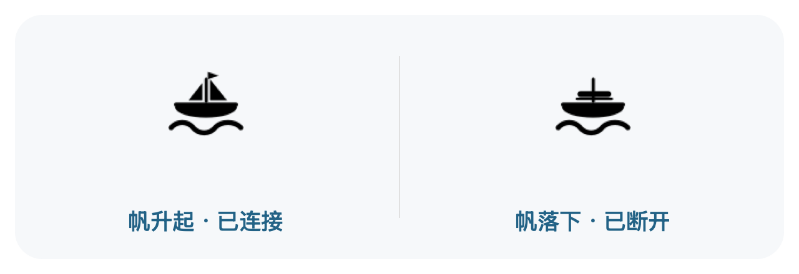
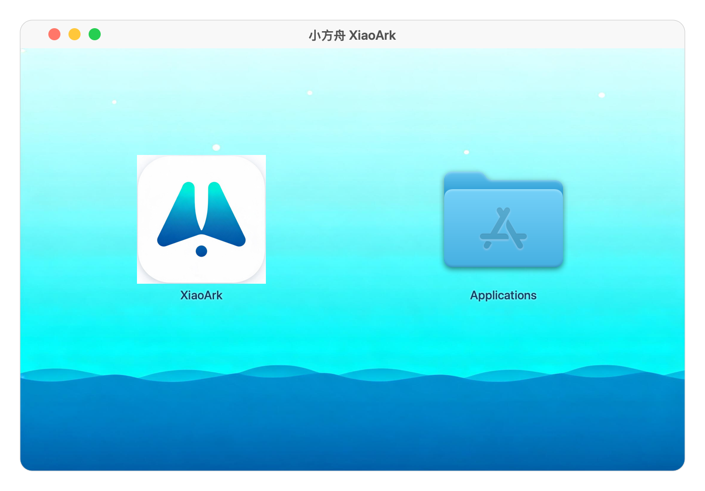

<div align="center">

<br/>


<br/><br/>

# 小方舟 · XiaoArk

**小小的船，渡大大的海。**

[](https://github.com/Shamnick/XiaoArk/releases)
[](https://github.com/Shamnick/XiaoArk/releases)
[](LICENSE)

*一款简洁、快速、自由的网络代理客户端 —— 由小小设计与维护*

</div>

---

## 🌊 缘起

信息的海洋辽阔无垠，但不是每一叶扁舟都能自由航行。

**小方舟**为此而生：它以海为名，以帆为形——图标上那一抹从 turquoise 浅滩渐入 deep sea blue 深海的渐变，是从近岸到远洋的旅程；扬起的帆是速度，帆下那一点是坐标，提醒你始终知道自己要去哪里。

它不臃肿、不喧哗。打开它，配置好航线，然后忘记它的存在——直到你抵达任何想去的彼岸。

## ✨ 功能特性

### 🚀 全协议支持

覆盖主流代理协议，一种订阅，全部兼容：

`VMess` · `VLESS` · `Trojan` · `Shadowsocks` · `ShadowsocksR` · `Hysteria / Hysteria2` · `TUIC` · `WireGuard` · `Socks5` · `HTTP`

### 🧭 智能分流

- **规则路由**：按域名、IP、地区自动分流，国内直连、海外代理
- **TUN 全局模式**：接管系统全部流量，不支持的协议也能代理
- **代理组策略**：手动选择、自动测速、负载均衡，随你调度
- **实时延迟测试**：每个节点的真实速度，一目了然

### 🔗 订阅管理

- 一键导入：支持 `xiaoark://`、`clash://` 订阅链接
- 多订阅并存，自动定时更新
- 支持二维码扫描导入（移动端）

### 🎨 现代体验

- Flutter 驱动的流畅界面，深浅色主题自动跟随系统
- 菜单栏托盘常驻：帆升起 = 已连接，帆收起 = 已断开
- 连接详情、流量统计、日志查看，排障不愁
- WebDAV 云备份：配置随心同步，换机零成本

### 🛡 独立与纯净

- 独立 Bundle ID 与配置目录，与任何同类软件和平共处
- 无广告、无埋点、无捆绑
- 开源透明，每一行代码可审阅

## 📸 界面预览

<div align="center">


**仪表盘** · 实时流量、节点延迟、连接统计，一屏尽览

<br/>



**菜单栏托盘** · 帆升起即已连接，帆落下即已断开，无需点开窗口

<br/>



**安装界面** · 海洋主题 DMG，从第一眼就是自己的样子

</div>

## ⬇️ 下载

前往 [**Releases**](https://github.com/Shamnick/XiaoArk/releases) 获取最新版本：

| 平台 | 架构 | 文件 |
|---|---|---|
| macOS | Apple Silicon (M 系列) | `XiaoArk-*-macos-arm64.dmg` |
| macOS | Intel | `XiaoArk-*-macos-amd64.dmg` |

### 安装

1. 打开下载的 `.dmg` 文件
2. 将 **XiaoArk.app** 拖入 **Applications**
3. 首次打开如遇安全提示：**系统设置 → 隐私与安全性 → 仍要打开**

## 🚀 快速上手

```text
① 获取订阅链接          → 从你的服务提供商处复制订阅地址
② 导入小方舟            → 配置页面 → 新建 → 粘贴链接 → 保存
③ 选择节点              → 代理页面 → 挑选延迟最低的节点
④ 启航                  → 首页打开开关，帆起即通
```

## 🎨 设计规范

| 元素 | 规范 |
|---|---|
| 中文名 | 小方舟 |
| 英文名 | XiaoArk |
| 主色 |  Turquoise `#30D5C8` |
| 辅色 |  Deep Sea Blue `#1B4F72` |
| 图标 | 白底圆角方块 · 一帆一点 · 海洋渐变 |
| 理念 | 极简、远航、可靠 |

## 🏗 技术架构

```text
┌─────────────────────────────────────────┐
│           XiaoArk 桌面 / 移动应用        │  Flutter · Dart
├─────────────────────────────────────────┤
│           Rust 服务桥接层                │  rust_api · helper
├─────────────────────────────────────────┤
│           Clash Meta (mihomo) 内核       │  Go · 规则引擎 · TUN
└─────────────────────────────────────────┘
```

- **界面层**：Flutter 跨平台渲染，一次设计，处处一致
- **桥接层**：Rust 编写的高性能服务通道，负责进程与权限管理
- **内核层**：Clash Meta 规则引擎，久经考验的代理核心
- **发布**：GitHub Actions 云端构建，推送标签即自动发版

## 🗺 路线图

- [x] macOS Apple Silicon 原生版
- [ ] 界面主题全面海洋化
- [ ] 首次启动引导页
- [ ] Windows / Linux / Android 云端构建
- [ ] 默认中文界面

## ❓ 常见问题

<details>
<summary><b>macOS 提示"已损坏，无法打开"？</b></summary>

这是未公证应用的常规提示。打开终端执行：

```bash
xattr -dr com.apple.quarantine /Applications/XiaoArk.app
```

</details>

<details>
<summary><b>订阅链接点不动？</b></summary>

确认链接以 `xiaoark://`、`clash://` 开头，或在应用内手动粘贴导入。

</details>

<details>
<summary><b>TUN 模式无法开启？</b></summary>

TUN 需要安装系统服务。在设置中按提示授权一次即可，之后自动生效。

</details>

---

<div align="center">

<br/>

**小方舟 · XiaoArk**

Made with 🌊 by 小小

<br/>

</div>
