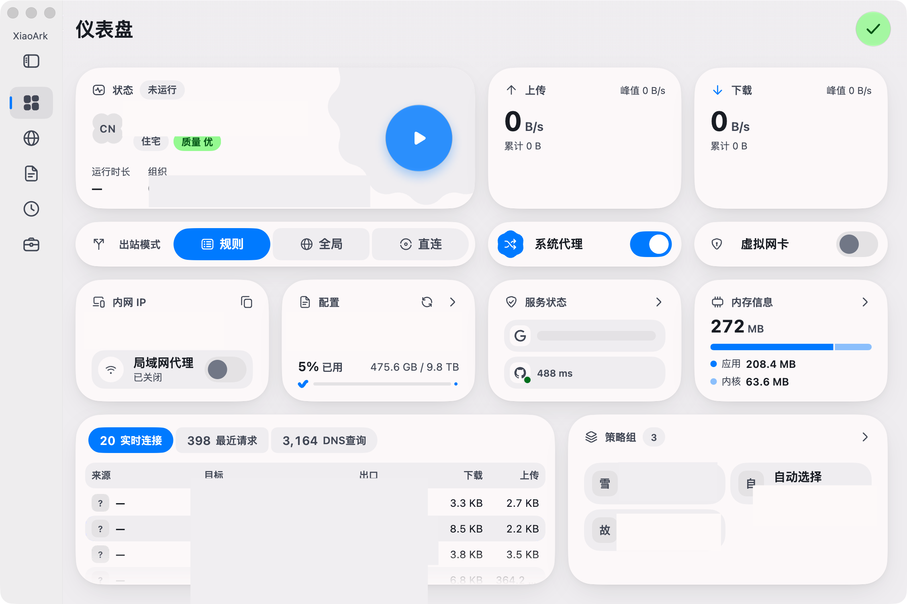

<div align="center">

<br/>


<br/>

# 小方舟 · XiaoArk

**小小的船，渡大大的海。** —— 为 macOS 精心打磨的全协议网络代理客户端

<br/>

[](https://github.com/Shamnick/XiaoArk/releases/latest)
[](https://github.com/Shamnick/XiaoArk/releases)
[](https://github.com/Shamnick/XiaoArk/releases)
[](LICENSE)
[](https://github.com/Shamnick/XiaoArk/stargazers)

**[⬇️ 下载](#️-下载) · [🚀 快速上手](#-快速上手) · [📸 界面预览](#-界面预览) · [🔨 源码构建](#-从源码构建) · [🤝 参与贡献](#-参与贡献) · [❓ FAQ](#-常见问题)**

**简体中文** · **[English](README_EN.md)**

</div>

---

**小方舟 XiaoArk** 是一款为 macOS 精心打磨的全协议网络代理客户端。它以海为名、以帆为形——图标上那抹从 turquoise 浅滩渐入 deep sea blue 的渐变，是从近岸到远洋的旅程。它不臃肿、不喧哗：打开它，配置好航线，然后忘记它的存在——直到你抵达任何想去的彼岸。

## ✨ 功能一览

| 类别 | 能力 |
|---|---|
| 🚀 协议 | `VMess` `VLESS` `Trojan` `Shadowsocks` `SSR` `Hysteria / Hysteria2` `TUIC` `WireGuard` `Socks5` `HTTP` |
| 🧭 分流 | 规则路由（域名 / IP / 地区）· TUN 全局接管 · 直连 / 代理组策略 · 实时延迟测速 |
| 🔗 订阅 | `xiaoark://` `clash://` 一键导入 · 多订阅并存 · 定时自动更新 · 二维码导入（移动端） |
| 🎨 体验 | Flutter 流畅界面 · 深浅色跟随系统 · 托盘双状态（帆起 = 连接 / 帆落 = 断开）· WebDAV 云备份 |
| 🛡 纯净 | 独立 Bundle ID 与配置目录 · 无广告 · 无埋点 · GPL-3.0 完全开源 |

<details>
<summary><b>展开：分流与代理组细节</b></summary>

- **规则路由**：按域名、IP、地区自动分流，国内直连、海外代理
- **TUN 全局模式**：接管系统全部流量，不支持代理协议的应用也能走代理
- **代理组策略**：手动选择、自动测速、负载均衡，随你调度
- **实时延迟测试**：每个节点的真实速度，一目了然

</details>

## 📸 界面预览

<div align="center">



**仪表盘** · 运行状态、实时速率、出站模式、系统代理、内存占用、实时连接、策略组——一屏尽览

运行状态卡片中央是启动/暂停键；出站模式一键切换规则 / 全局 / 直连；菜单栏托盘以帆的起落提示连接状态，无需点开窗口。

</div>

## ⬇️ 下载

前往 [**Releases**](https://github.com/Shamnick/XiaoArk/releases) 获取最新版本：

| 平台 | 架构 | 文件 |
|---|---|---|
| macOS | Apple Silicon（M 系列，**推荐**） | `XiaoArk-*-macos-arm64.dmg` |
| macOS | Intel | `XiaoArk-*-macos-amd64.dmg` |

### 安装

1. 打开下载的 `.dmg` 文件
2. 将 **XiaoArk.app** 拖入 **Applications**
3. 首次打开如遇安全提示：**系统设置 → 隐私与安全性 → 仍要打开**

## 🚀 快速上手

```text
① 获取订阅链接          → 从你的服务提供商处复制订阅地址
② 导入小方舟            → 配置页面 → 新建 → 粘贴链接 → 保存
③ 选择节点              → 代理页面 → 挑选延迟最低的节点
④ 启航                  → 首页打开开关，帆起即通
```

## 🔨 从源码构建

本项目完全开源，欢迎自行构建验证：

```bash
git clone https://github.com/Shamnick/XiaoArk.git
cd XiaoArk

flutter pub get                      # 安装依赖
dart setup.dart macos --env stable   # 构建并打包（产物在 dist/）
```

> 要求：Flutter `3.47.6`、Xcode（macOS 构建）、Go `1.27+`。更多细节见 [.agents/commands.md](.agents/commands.md)。

每个 Release 均由 [GitHub Actions](.github/workflows/release.yaml) 云端从源码构建，与你看到的一行一行代码一一对应。

## 🏗 技术架构

```text
┌─────────────────────────────────────────┐
│           XiaoArk 桌面 / 移动应用        │  Flutter · Dart
├─────────────────────────────────────────┤
│           Rust 服务桥接层                │  rust_api · helper
├─────────────────────────────────────────┤
│           Clash Meta (mihomo) 内核       │  Go · 规则引擎 · TUN
└─────────────────────────────────────────┘
```

- **界面层**：Flutter 跨平台渲染，一次设计，处处一致
- **桥接层**：Rust 编写的高性能服务通道，负责进程与权限管理
- **内核层**：Clash Meta 规则引擎，久经考验的代理核心
- **发布**：GitHub Actions 云端构建，推送标签即自动发版

## 🗺 路线图

- [x] macOS Apple Silicon 原生版
- [ ] 界面主题全面海洋化
- [ ] 首次启动引导页
- [ ] Windows / Linux / Android 云端构建
- [ ] 默认中文界面

## 🤝 参与贡献

小方舟是个人项目，但不拒绝任何同行的船桨：

- 🐛 [提交 Issue](https://github.com/Shamnick/XiaoArk/issues)：崩溃、异常、功能建议都欢迎
- 💬 [参与讨论](https://github.com/Shamnick/XiaoArk/discussions)：使用问题、经验分享
- 🔀 Pull Request：修复或改进，提交前请先开一个 Issue 说明动机
- ⭐ 一个 Star，就是最好的鼓励

## ❓ 常见问题

<details>
<summary><b>macOS 提示“已损坏，无法打开”？</b></summary>

这是未公证应用的常规提示。打开终端执行：

```bash
xattr -dr com.apple.quarantine /Applications/XiaoArk.app
```

</details>

<details>
<summary><b>订阅链接点不动？</b></summary>

确认链接以 `xiaoark://`、`clash://` 开头，或在应用内手动粘贴导入。

</details>

<details>
<summary><b>TUN 模式无法开启？</b></summary>

TUN 需要安装系统服务。在设置中按提示授权一次即可，之后自动生效。

</details>

## ⭐ Star 趋势

[](https://star-history.com/#Shamnick/XiaoArk&Date)

## 🙏 致谢

本项目基于 [FlClash](https://github.com/chen08209/FlClash)（GPL-3.0）二次开发，感谢原作者与 [mihomo](https://github.com/MetaCubeX/mihomo) 内核社区的贡献。XiaoArk 与上游的所有差异均在本仓库中公开审阅。

## 📜 许可证

[GPL-3.0](LICENSE) © 2026 xiaoxiao

---

<div align="center">

**小方舟 · XiaoArk** — 小小的船，渡大大的海

Made with 🌊 by 小小

</div>
