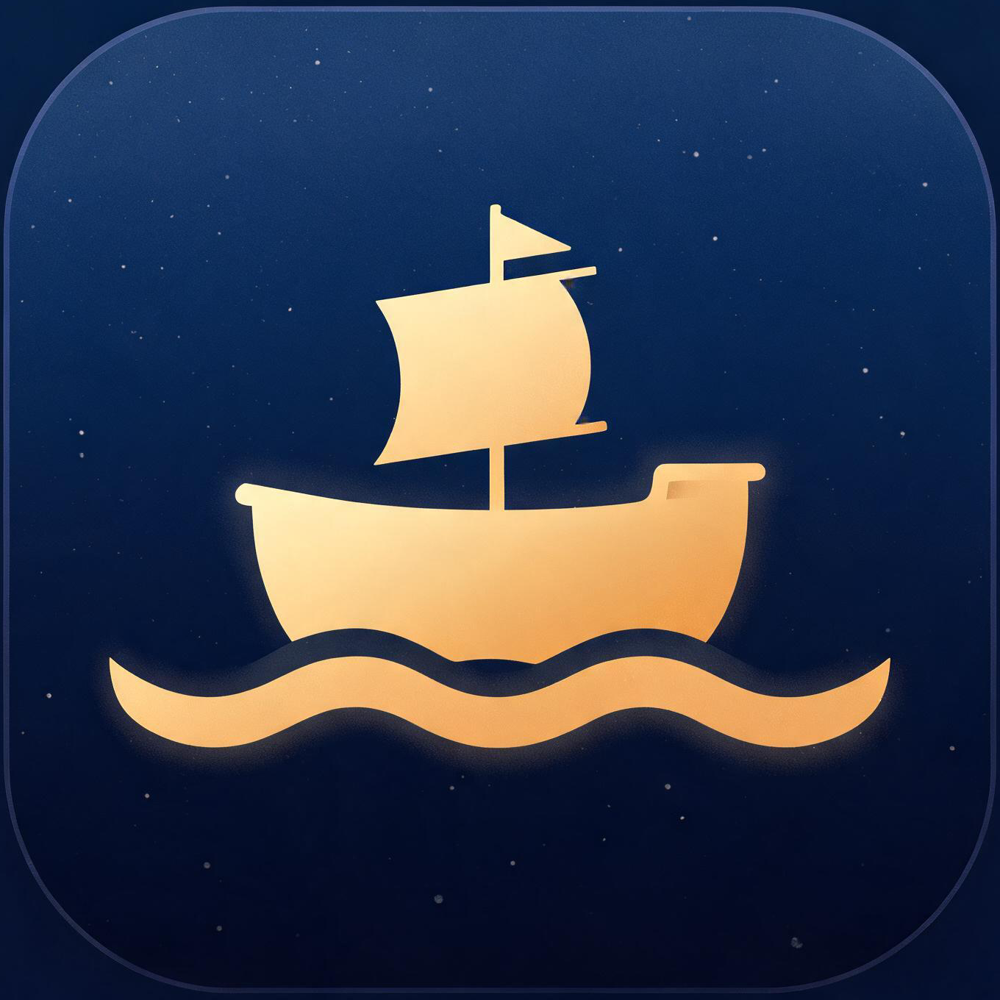

# 小方舟 XiaoArk

**载你出海，自由联通。**

一款专属定制的网络代理客户端，基于开源项目 [FlClash](https://github.com/chen08209/FlClash) 深度品牌重塑。

---

## ✨ 简介

小方舟（XiaoArk）是基于 FlClash 0.9.3 的个性化定制版本，由 **小小** 专属打造。在保留原版全部强大功能的基础上，完成了全方位的品牌重塑：

- 🚢 **全新品牌**：FlClash → XiaoArk，应用名、Bundle ID、URL 协议（`xiaoark://`）全面更名
- 🎨 **专属视觉**：深蓝星空 + 金色方舟主题图标，Dock、启动台、菜单栏托盘全套替换
- 🔏 **独立签名**：重签名封装，与原版互不影响，配置完全独立

## 📦 功能特性

继承 FlClash 的全部能力：

- 多协议支持：VMess / VLESS / Trojan / Shadowsocks / Hysteria 等
- 基于 Clash Meta（mihomo）内核，规则分流、TUN 模式
- 订阅管理、一键导入（兼容 `clash://` 订阅链接）
- 多平台内核，简洁现代的 Flutter 界面

## ⬇️ 下载安装

前往 [Releases](../../releases) 页面下载最新版本：

| 平台 | 文件 |
|---|---|
| macOS (Intel) | `XiaoArk-0.9.3-macos-amd64.dmg` |

下载后打开 DMG，将 **XiaoArk.app** 拖入 Applications 即可。

> 首次打开如遇安全提示：系统设置 → 隐私与安全性 → 仍要打开。

## 🎨 品牌主题

| 元素 | 设计 |
|---|---|
| 名称 | 小方舟 / XiaoArk |
| 主题色 | 深海军蓝 × 金色 |
| 图标 | 星夜海浪上的金色小方舟 |
| 寓意 | 载你出海远航，抵达任何彼岸 |

## 🙏 致谢

本项目基于 [FlClash](https://github.com/chen08209/FlClash) 构建，感谢原作者及所有贡献者。原项目遵循其开源许可证，本仓库仅作个人品牌化定制与分发。

---

Made with ❤️ by 小小

