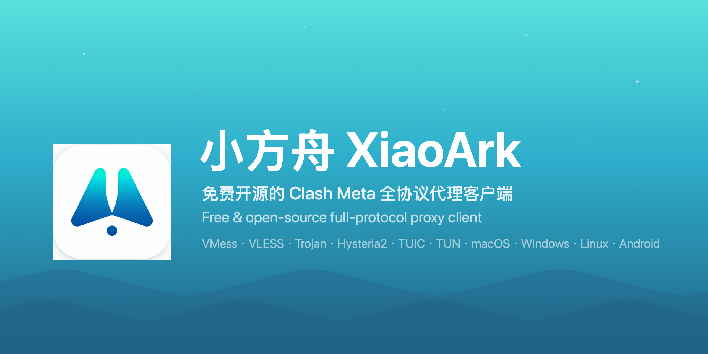
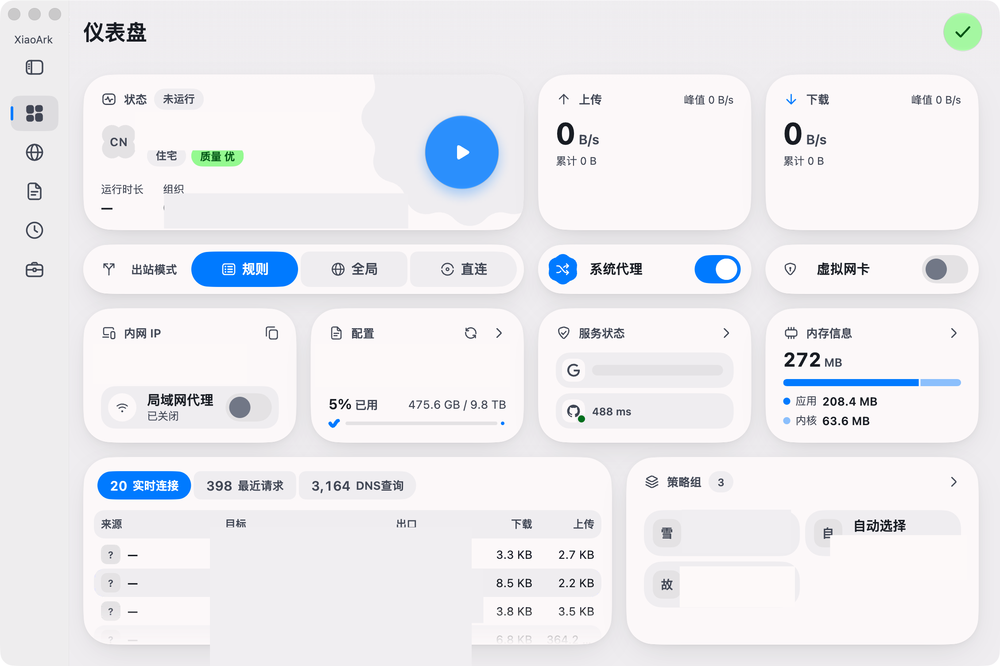
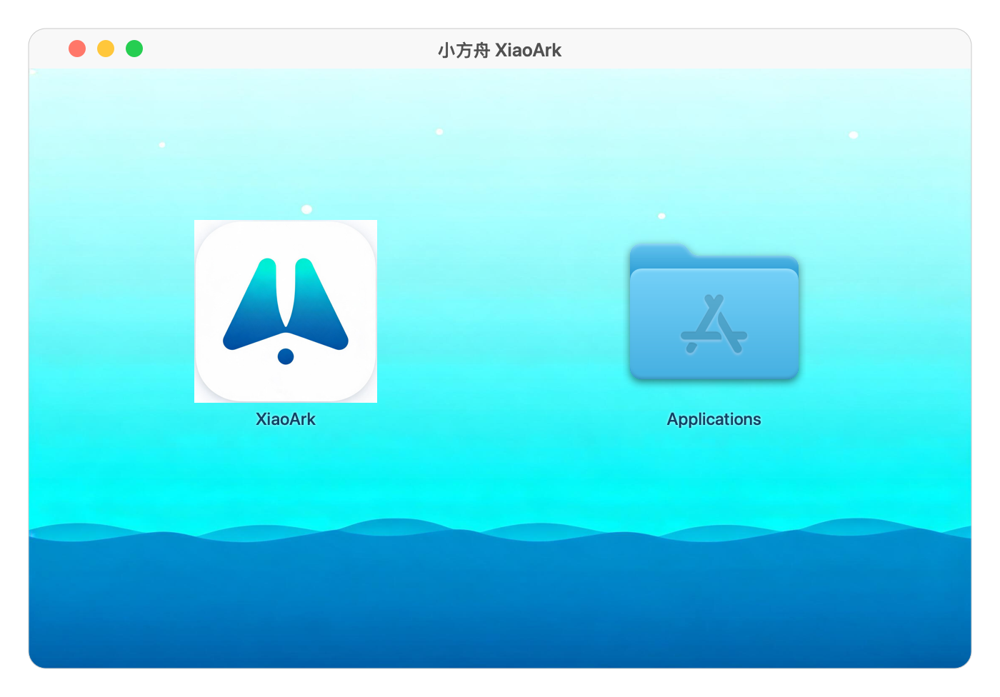

<div align="center">



<br/>

[](https://github.com/Shamnick/XiaoArk/releases/latest)
[](https://github.com/Shamnick/XiaoArk/releases)
[](https://github.com/Shamnick/XiaoArk/releases)
[](LICENSE)
[](https://github.com/Shamnick/XiaoArk/stargazers)

**[⬇️ Download](#️-download) · [🚀 Quick Start](#-quick-start) · [📸 Screenshots](#-screenshots) · [🔨 Build](#-build-from-source) · [🤝 Contributing](#-contributing) · [❓ FAQ](#-faq)**

**[简体中文](README.md)** · **English**

</div>

---

**XiaoArk** is a full-protocol network proxy client, carefully crafted for macOS. Named after the sea, shaped like a sail — the gradient on its icon, from turquoise shallows to deep sea blue, is a journey from the coast to the open ocean. It is not bloated, not noisy: open it, set your course, then forget it exists — until you arrive at any shore you wish.

## ✨ Features

| Category | Capabilities |
|---|---|
| 🚀 Protocols | `VMess` `VLESS` `Trojan` `Shadowsocks` `SSR` `Hysteria / Hysteria2` `TUIC` `WireGuard` `Socks5` `HTTP` |
| 🧭 Routing | Rule-based (domain / IP / region) · TUN global mode · Direct / proxy groups · Real-time latency test |
| 🔗 Subscription | `xiaoark://` `clash://` one-click import · Multiple subscriptions · Scheduled auto-update · QR scan (mobile) |
| 🎨 Experience | Fluent Flutter UI · Light/dark auto theme · Dual-state tray (sail up = connected / down = disconnected) · WebDAV backup |
| 🛡 Clean | Independent Bundle ID & config dir · No ads · No tracking · GPL-3.0 open source |

<details>
<summary><b>Expand: routing & proxy groups</b></summary>

- **Rule routing**: auto-switch by domain, IP or region — direct at home, proxied abroad
- **TUN global mode**: captures all system traffic, even apps without native proxy support
- **Proxy groups**: manual selection, auto latency-test, load balancing — your call
- **Real-time latency**: the true speed of every node, at a glance

</details>

## 📸 Screenshots

<div align="center">



**Dashboard** · real-time traffic, node latency and connection stats in one view

<br/>


**Menu-bar Tray** · sail up means connected, sail down means disconnected — no need to open the window

<br/>



**Installer** · ocean-themed DMG — it looks like our own from the very first glance

</div>

## ⬇️ Download

Get the latest version from [**Releases**](https://github.com/Shamnick/XiaoArk/releases):

| Platform | Architecture | File |
|---|---|---|
| macOS | Apple Silicon (M series, **recommended**) | `XiaoArk-*-macos-arm64.dmg` |
| macOS | Intel | `XiaoArk-*-macos-amd64.dmg` |

### Install

1. Open the downloaded `.dmg`
2. Drag **XiaoArk.app** into **Applications**
3. If macOS warns on first launch: **System Settings → Privacy & Security → Open Anyway**

## 🚀 Quick Start

```text
① Get a subscription link   → copy the subscription URL from your provider
② Import into XiaoArk       → Profiles page → New → paste the link → Save
③ Pick a node               → Proxies page → choose the node with lowest latency
④ Set sail                  → flip the switch on the home page — sail up, online
```

## 🔨 Build from Source

Fully open source — build and verify it yourself:

```bash
git clone https://github.com/Shamnick/XiaoArk.git
cd XiaoArk

flutter pub get                      # install dependencies
dart setup.dart macos --env stable   # build & package (artifacts in dist/)
```

> Requires Flutter `3.47.6`, Xcode (for macOS builds) and Go `1.27+`. See [.agents/commands.md](.agents/commands.md) for details.

Every release is built in the cloud by [GitHub Actions](.github/workflows/release.yaml) — byte-for-byte from the exact source you can read here.

## 🏗 Architecture

```text
┌─────────────────────────────────────────┐
│        XiaoArk desktop / mobile app      │  Flutter · Dart
├─────────────────────────────────────────┤
│        Rust service bridge               │  rust_api · helper
├─────────────────────────────────────────┤
│        Clash Meta (mihomo) core          │  Go · rule engine · TUN
└─────────────────────────────────────────┘
```

- **UI layer**: Flutter cross-platform rendering — designed once, consistent everywhere
- **Bridge layer**: high-performance service channel in Rust for process & privilege management
- **Core layer**: the battle-tested Clash Meta proxy engine
- **Release**: GitHub Actions cloud builds — push a tag, get a release

## 🗺 Roadmap

- [x] macOS Apple Silicon native build
- [ ] Full ocean-themed UI
- [ ] First-launch onboarding
- [ ] Windows / Linux / Android cloud builds
- [ ] Chinese as the default UI language

## 🤝 Contributing

XiaoArk is a personal project, but every paddle is welcome aboard:

- 🐛 [Open an Issue](https://github.com/Shamnick/XiaoArk/issues): crashes, bugs and feature requests
- 💬 [Join Discussions](https://github.com/Shamnick/XiaoArk/discussions): questions and experience sharing
- 🔀 Pull Requests: please open an Issue first to describe the motivation
- ⭐ A Star is the best encouragement

## ❓ FAQ

<details>
<summary><b>macOS says the app is "damaged and can't be opened"?</b></summary>

Standard warning for unsigned apps. Run in Terminal:

```bash
xattr -dr com.apple.quarantine /Applications/XiaoArk.app
```

</details>

<details>
<summary><b>Subscription link doesn't respond?</b></summary>

Make sure it starts with `xiaoark://` or `clash://`, or paste it manually inside the app.

</details>

<details>
<summary><b>Can't enable TUN mode?</b></summary>

TUN requires a system service. Authorize it once when prompted in Settings — it works automatically afterwards.

</details>

## ⭐ Star History

[](https://star-history.com/#Shamnick/XiaoArk&Date)

## 🙏 Credits

This project is a derivative work based on [FlClash](https://github.com/chen08209/FlClash) (GPL-3.0). Huge thanks to the original author and the [mihomo](https://github.com/MetaCubeX/mihomo) core community. All changes made by XiaoArk are publicly auditable in this repository.

## 📜 License

[GPL-3.0](LICENSE) © 2026 xiaoxiao

---

<div align="center">

**XiaoArk · 小方舟** — a tiny boat, sailing across the vast sea

Made with 🌊 by xiaoxiao

</div>
